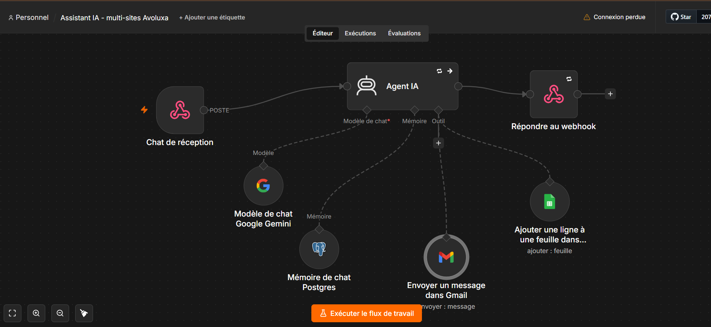

# AVOLUXA – Chatbot commercial IA (n8n)

Assistant de vente conversationnel pour boutique e-commerce, construit avec n8n. Il conseille le client, l'oriente vers des packs, enregistre la commande dans Google Sheets et peut envoyer un email de confirmation.



## Fonctionnalités
- Conversation de vente (méthode problème → solution → closing)
- Mémoire de conversation par session (PostgreSQL)
- Enregistrement automatique des commandes (Google Sheets)
- Email de confirmation optionnel (Gmail)
- Webhook intégrable sur n'importe quel site web

## Stack
n8n · Google Gemini · PostgreSQL · Google Sheets · Gmail

## Installation
1. Importer `workflow.json` dans n8n (Workflows → Import from file).
2. Créer vos credentials : Gemini, Postgres, Gmail OAuth2, Google Sheets OAuth2 (voir `.env.exemple`).
3. Créer un Google Sheet avec l'onglet `Avoluxa` et les colonnes de `donnees/commandes-modele.csv`.
4. Renseigner l'ID du Sheet dans le nœud Google Sheets.
5. Adapter le prompt (`documents/system-prompt.md`) : produits, prix, numéro WhatsApp.
6. Activer le workflow et copier l'URL du webhook.

## Utilisation
Envoyer une requête POST au webhook :

```json
{
  "chatInput": "Salut, je veux une tondeuse",
  "sessionId": "identifiant-unique-visiteur"
}
```

La réponse est renvoyée par le nœud *Respond to Webhook*.

## Personnalisation
Modifiez le system prompt pour adapter produits, ton et règles de vente à votre boutique.

## Sécurité
Aucune clé ni credential dans ce dépôt. Restreignez `allowedOrigins` du webhook à votre domaine en production.

## Licence
MIT
